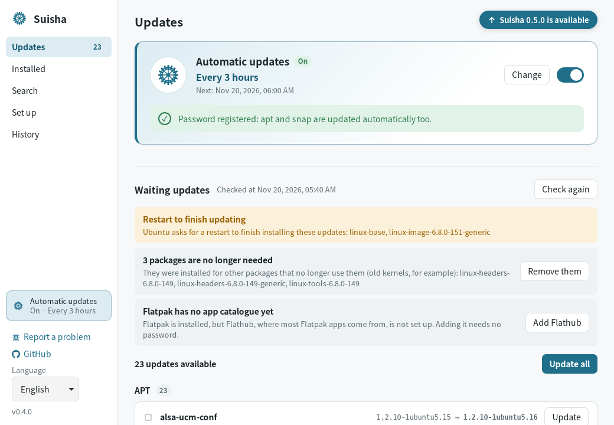

[English](README.md) | 日本語

# Suisha（水車）

[問題の報告・要望はこちら（GitHub Issues）](https://github.com/moriyama-dev/suisha/issues)

Suisha は、Ubuntu と macOS に入っているソフトウェアを、自動で最新に保ちます。
すでに使っているパッケージマネージャーを1つの画面にまとめるので、どのアプリをどの道具で入れたかを覚えていなくても、検索・インストール・更新・削除ができます。
サーバーや SSH の先では、同じことを `suisha` コマンド1つで行えます。

| | 対応しているもの |
|---|---|
| **Ubuntu** 22.04 以降 | **apt**、**snap**、**Flatpak**、**Homebrew**（Linux 版） |
| **macOS** 13 Ventura 以降 | **Homebrew**（formula と cask）、**Mac App Store**（[mas](https://github.com/mas-cli/mas) を通して） |

Suisha は無料のオープンソースです。あなたやコンピューターの情報をどこにも送りません。実行するコマンド（`brew upgrade`、`apt-get upgrade` など）は、すべて表示します。



## できること

- **自動更新**：初めは 1 時間ごとです。3・6・12 時間ごと、毎日、または週に1回にも変えられます。その時刻にシステムのタイマー（Ubuntu では systemd、macOS では launchd）が Suisha を起動して、すべてを更新します。Suisha の画面を閉じていても動きます。更新したときや失敗したときは通知で知らせます。画面を開いている間は、30 分ごとにも新しい更新がないか確認します
- **まとめて更新**：すべてを一度に、または選んだものだけを更新できます。Ubuntu の段階的な配信（apt があとで自動で入れる更新）は別にまとめて表示するので、件数には今すぐ入れられるものだけが出ます。macOS では Mac App Store のアプリも一覧に出て、**App Store を開く** を押すと App Store の「アップデート」がそのまま開きます
- **まとめて検索**：すべてのパッケージマネージャーを一度に検索し、結果からそのままインストールできます
- **インストール済みの一覧**：パッケージマネージャーごとに表示し、いらないものを削除できます。依存関係で入ったものや、システムの土台になるパッケージは表示しないので、うっかり消すことはありません
- **新しいコンピューターのセットアップ**：アプリの一覧をファイルに保存し、新しいコンピューターや入れ直したコンピューターで開くと、入っていないものをまとめてインストールします
- **ターミナルを開かなくて済むお知らせ**（Ubuntu）：更新を完了するために再起動が必要なとき、不要になったパッケージがあるとき（ボタン1つで削除）、Flatpak にアプリの一覧がまだないとき（ボタン1つで Flathub を追加）に知らせます
- **記録**：インストール・削除・更新を、自動で行ったものも含めてすべて記録します。記録を残す期間は、3 日・30 日・100 日・400 日・好きな日数・ずっと残す・残さない、から選べます。初期値は 100 日です
- 英語と日本語に対応しています

Suisha は、パッケージの一覧を自分では持っていません。表示する内容はすべて、このコンピューターのパッケージマネージャーから取得しています。


## サーバーやターミナルで使う

`suisha` コマンドは、画面でできることを、デスクトップなしで行います。画面版を入れると一緒に入ります。サーバーでは、小さな `suisha-cli` パッケージだけを入れられます（[インストール](#ubuntu)）。

```console
$ suisha status
Suisha 0.6.1

更新
  apt   7 件の更新  61 件インストール済み
  snap  最新です    4 件インストール済み
  入れるには：suisha update

自動更新
  毎日 03:00
  対象：すべて
  次回：2026-11-25 03:03
  前回：2026-11-24 03:15
```

| | |
|---|---|
| `suisha status` | 更新の有無、自動更新の予定、システムからのお知らせ（再起動、不要になったパッケージ） |
| `suisha updates` | 更新があるものの一覧 |
| `suisha update` | すべての更新を入れる。`suisha update apt:git` なら、そのパッケージだけ |
| `suisha on` | 自動で更新する：1時間ごとに、すべてのパッケージマネージャーの更新を確かめて、あれば入れます。止めるときは `suisha off` |
| `suisha schedule set daily 03:00` | 別の時刻に自動で更新する。`weekly sun 03:00` や `every 6h` も指定できます |
| `suisha list`、`suisha search 名前` | 入っているものの一覧。すべてのパッケージマネージャーからの検索 |
| `suisha install apt:htop snap:btop`、`suisha remove htop` | インストールと削除 |
| `suisha cleanup` | 不要になったパッケージを削除する（`apt autoremove`） |
| `suisha export apps.json`、`suisha setup apps.json` | 入っているアプリの一覧を保存する。別のサーバーで、その一覧から入れる |
| `suisha history` | 変更したことの記録（新しい順。自動更新も含みます） |
| `suisha self-update` | Suisha 自体を更新する |
| `suisha report`、`suisha request` | 問題を報告、要望を伝える：版の情報が入った GitHub の新しい Issue へのリンクを表示します |

- パッケージは「マネージャー:名前」の形で書きます。`suisha list` と `suisha search` の表示と同じです
- 何かを変更する前に、これから実行するコマンドを表示して、確認を求めます。`--yes` を付けると確認を省き、`--dry-run` を付けるとコマンドを表示するだけで実行しません
- `--json` を付けると、結果を JSON で出します（スクリプト用）。終了コードは、成功が 0、失敗が 1、コマンドの書き方が読み取れないときが 2 です
- メッセージは、システムの言語に合わせて英語か日本語で出ます
- `suisha help` で、すべてのコマンドを見られます

サーバーでは、ほとんどの時間、誰もログインしていません。そのため `suisha on` と `suisha schedule set …` は、ログアウトしている間もあなたのユーザーのタイマーが動くようにします（`loginctl enable-linger`）。毎回の結果は、`suisha history` と `journalctl --user -u suisha-auto-update` で確認できます。

## インストール

### macOS

macOS 13 Ventura 以降に対応しています。Apple シリコンの Mac でも、Intel の Mac でも動きます。

**Homebrew で入れる（おすすめ。以後は Suisha が自分で最新に保ちます）**

```sh
brew tap moriyama-dev/suisha https://github.com/moriyama-dev/suisha
brew install --cask moriyama-dev/suisha/suisha
```

Mac App Store のアプリも表示・更新したいときは、mas も入れます。

```sh
brew install mas
```

**ダウンロードしたディスクイメージから**

[Releases](https://github.com/moriyama-dev/suisha/releases) のページから `suisha-<版>-macos-universal.dmg` をダウンロードして開き、**Suisha** を **アプリケーション**（Applications）にドラッグします。

Suisha は Apple の公証（notarization）を受けていないため、最初に開くときに、macOS が「確認できない」と表示します。**システム設定 → プライバシーとセキュリティ** を開き、Suisha についての表示の横にある **このまま開く**（Open Anyway）を押してください。または、ターミナルで次を1回実行します。

```sh
xattr -dr com.apple.quarantine /Applications/Suisha.app
```

この方法で入れた Suisha は、自分では更新できません。新しい版が出ると、ダウンロードのページへのリンクをお知らせに出します。Homebrew で入れれば、どちらの手間もかかりません。

### Ubuntu

Ubuntu 22.04 以降、x64 に対応しています。

**apt リポジトリから**

```sh
sudo install -d -m 0755 /etc/apt/keyrings
curl -fsSL https://moriyama-dev.github.io/suisha/suisha-archive-keyring.gpg | sudo tee /etc/apt/keyrings/suisha-archive-keyring.gpg > /dev/null
echo "deb [arch=amd64 signed-by=/etc/apt/keyrings/suisha-archive-keyring.gpg] https://moriyama-dev.github.io/suisha stable main" | sudo tee /etc/apt/sources.list.d/suisha.list > /dev/null
sudo apt update
sudo apt install suisha        # デスクトップのあるコンピューター：画面とコマンド
sudo apt install suisha-cli    # サーバー：コマンドだけ。デスクトップ用のライブラリは入りません
```

どちらか一方を入れてください。`suisha` を入れると、`suisha-cli` も一緒に入ります。

**ダウンロードしたパッケージから**

[Releases](https://github.com/moriyama-dev/suisha/releases) のページから `suisha-cli-<版>-linux-amd64.deb` と、画面も使うときは `suisha-<版>-linux-amd64.deb` をダウンロードして、次を実行します。

```sh
sudo apt install ./suisha-cli-0.6.1-linux-amd64.deb ./suisha-0.6.1-linux-amd64.deb   # デスクトップあり
sudo apt install ./suisha-cli-0.6.1-linux-amd64.deb                                   # サーバー
```

どちらの方法でも、以後は Suisha 自体も更新されます。パッケージを入れると、Suisha の apt リポジトリ（`/etc/apt/sources.list.d/suisha.list`）が、まだなければ登録されるためです。
リポジトリの署名鍵のフィンガープリントは `5E50 CE53 AC3D C290 5D94  3D67 F3A3 49A9 8664 021E` です。

## 自動更新のしくみ

Suisha は、裏で常に動いているわけではありません。自動更新をオンにすると、システムにタイマーを登録します。

- **Ubuntu**：systemd のユーザータイマー（`~/.config/systemd/user/suisha-auto-update.timer`）。その時刻に電源が切れていたときは、次にログインしたあとで更新します。デスクトップのないターミナル（サーバー）から予約したときは、あなたのユーザーの linger も有効にするので、誰もログインしていない間もタイマーが動きます
- **macOS**：launchd のエージェント（`~/Library/LaunchAgents/dev.moriyama.suisha.auto-update.plist`）。Mac がスリープ中だったときは、復帰したあとで更新します。出力は `~/Library/Logs/Suisha/auto-update.log` に残ります


パッケージの配信元は新しい版が出たことを知らせてくれないので、Suisha は決まった間隔で確認します。負担を抑えるため、いちばん短い間隔は 1 時間です。

タイマーは `suisha --auto-update` を起動します。選んだパッケージマネージャーをすべて更新し、結果を記録に書き、通知を出します。
自動更新をオフにすると、タイマーは消えます。

Mac App Store のアプリは、Suisha の自動更新には含めません。App Store の設定で **自動アップデート** をオンにすると、App Store が自分で更新します。

### macOS でのパスワード

Homebrew は、ほとんどのアプリで管理者のパスワードを必要としません。一部の cask は、管理者の権限が必要なインストーラーを実行します。そのようなアプリを画面から更新・インストールするときは、Suisha が macOS のパスワード入力画面を出します（Homebrew は `sudo -A` で尋ねます）。入力したパスワードは `sudo` にそのまま渡り、Suisha は保存しません。予定の時刻に行う自動更新ではパスワードを聞かないので、そのようなアプリは、画面から更新するまで、記録に「失敗」として残ります。

`mas` は、App Store のアプリのインストールと更新に管理者の権限を必要とし、パスワードをターミナルで尋ねます。画面からはこれに答えられないため、インストールと更新は App Store にまかせます。**App Store で開く** でそのアプリのページを、**App Store を開く** で「アップデート」を開きます。

### Ubuntu でのパスワード

apt と snap は管理者の権限が必要です。画面からは OS 標準のパスワード入力（polkit）で、`suisha` コマンドからはターミナルの `sudo` で権限を求めます。root で実行したときは、何も尋ねません。

- **手動でインストール・削除・更新するとき**は、パスワードを求められます。入力したパスワードは数分間有効です
- **自動更新**のときは、パスワードを入力する人がいません。そこで、自動更新をオンにするとき（または自動更新の欄の **パスワードを登録** を押したとき）に1回だけパスワードを求め、決まった1つの処理（`/usr/lib/suisha/suisha-auto-update`）に限って、あなたのユーザーがパスワードなしで実行できるようにします。この処理は引数を受け取らず、`apt-get update`、`apt-get upgrade`、`snap refresh` だけを実行します。ほかの操作がパスワードなしで通るようになることはありません
  - 画面からオンにしたときは、polkit のルールを追加します
  - コマンドからオンにしたときは、`/etc/sudoers.d/suisha-auto-update-<あなたのユーザー ID>` に1行を書きます。置く前に `visudo` で検査します
- 自動更新をオフにすると、もう一度パスワードを求めて、この許可を消します。Suisha を削除したときも消えます

Flatpak と Homebrew は、管理者の権限なしで動きます。

## Suisha 自体の更新

- **ほかのパッケージと一緒に**：Ubuntu では、Suisha は自分のリポジトリから配っている apt のパッケージです。「すべて更新」、自動更新、ふつうの `sudo apt upgrade` のどれでも更新されます。macOS では、Suisha は Homebrew の cask です。「すべて更新」、自動更新、`brew upgrade` のどれでも更新されます
- **右上のボタンから**：Suisha の版を表示していて、新しい版が出るとお知らせに変わります。**今すぐ Suisha を更新** で新しい版を入れ、**Suisha を再起動** で切り替えます。ターミナルでは `suisha self-update` が同じことをします
- **自動で**：同じ場所の **Suisha を自動で更新する** をオンにするか、`suisha self-update --auto on` を実行します。1日に1回、システムが `suisha --self-update` を実行します
  - Ubuntu では、systemd のユーザータイマーが実行します。オンにするときに1回だけパスワードを求め、決まった1つの処理（`/usr/lib/suisha/suisha-self-update`）に限って、あなたのユーザーがパスワードなしで実行できるようにします。この処理は引数を受け取らず、Suisha の apt の取得元を更新して `suisha-cli` と `suisha` のパッケージを更新するだけです
  - macOS では、launchd のエージェントが `brew upgrade --cask moriyama-dev/suisha/suisha` を実行します。パスワードは要りません。Suisha を Homebrew で入れている必要があります


新しい版があるかを知るため、画面は起動したときと、開いている間は 6 時間ごとに、GitHub に Suisha の最新のリリースを問い合わせます。コマンドが問い合わせるのは、`suisha self-update` を実行したときだけです。取得するのは公開されているリリースの情報だけで、あなたやコンピューターの情報は送りません。

## 保存するアプリの一覧

画面の **セットアップ → 一覧を保存…**、またはターミナルの `suisha export apps.json` で、次のような JSON ファイルを書き出します。

```json
{
  "format": "suisha-setup",
  "version": 1,
  "os": "linux",
  "exportedAt": "2026-11-20T02:20:07Z",
  "packages": [
    { "manager": "apt", "id": "git" },
    { "manager": "snap", "id": "code", "classic": true },
    { "manager": "flatpak", "id": "org.gimp.GIMP", "name": "GNU Image Manipulation Program", "origin": "flathub", "scope": "system" }
  ]
}
```

中身はパッケージの名前だけです。設定やファイル、個人の情報は入りません。
一覧は、同じ種類のシステムの間で使うためのものです。macOS で保存した一覧（`"os": "macos"`。`brew`、`brew-cask`、`mas` の項目が入ります）は別の Mac で、Ubuntu で保存した一覧は別の Ubuntu のコンピューターで開けます。
Mac では、一覧にある App Store のアプリは、1つずつ App Store のページを開くので、そこでインストールしてください。
ターミナルでは、`suisha setup apps.json` が、一覧にあってこのコンピューターに無いものを表示して、インストールします。

## ソースからビルドする

コードは、1つの Cargo ワークスペースです。

| | |
|---|---|
| `crates/core` | パッケージマネージャーの読み取りと操作、予約、記録、設定 |
| `crates/cli` | `suisha` コマンド |
| `src-tauri`、`src` | 画面（Tauri と Svelte） |
| `packaging/linux` | root 用の処理、polkit の設定、パッケージのスクリプト |

コマンドだけなら、Rust（stable）があればビルドできます。

```sh
git clone https://github.com/moriyama-dev/suisha.git
cd suisha
cargo run -p suisha-cli -- status                  # コマンドを実行
cargo build --release -p suisha-cli                # ビルド
scripts/build-cli-deb.sh                           # Ubuntu：suisha-cli の .deb を作る
```

画面には、Node.js 22 も必要です。Ubuntu では、WebKitGTK の開発用ファイルも入れます。

```sh
sudo apt install libwebkit2gtk-4.1-dev libayatana-appindicator3-dev librsvg2-dev libssl-dev libxdo-dev build-essential
```

macOS では、Xcode のコマンドラインツール（`xcode-select --install`）を入れます。

```sh
npm ci
npm run tauri dev                                  # 開発モードで起動
npm run tauri build                                # Ubuntu：.deb を作る
npm run tauri build -- --bundles app,dmg           # macOS：アプリとディスクイメージを作る
```

テスト：

```sh
npm run check                  # 画面の型チェック
cargo test --workspace         # 出力の解析、スケジュール（systemd と launchd）、一覧ファイル、コマンドライン、入力の検査
```

Suisha は [Tauri](https://tauri.app/)（Rust）と [Svelte](https://svelte.dev/) で作っています。
パッケージマネージャーのコマンドはすべて Rust 側で、シェルを通さずに実行し、パッケージ名は渡す前に検査しています。

## ライセンス

[MIT](LICENSE)
