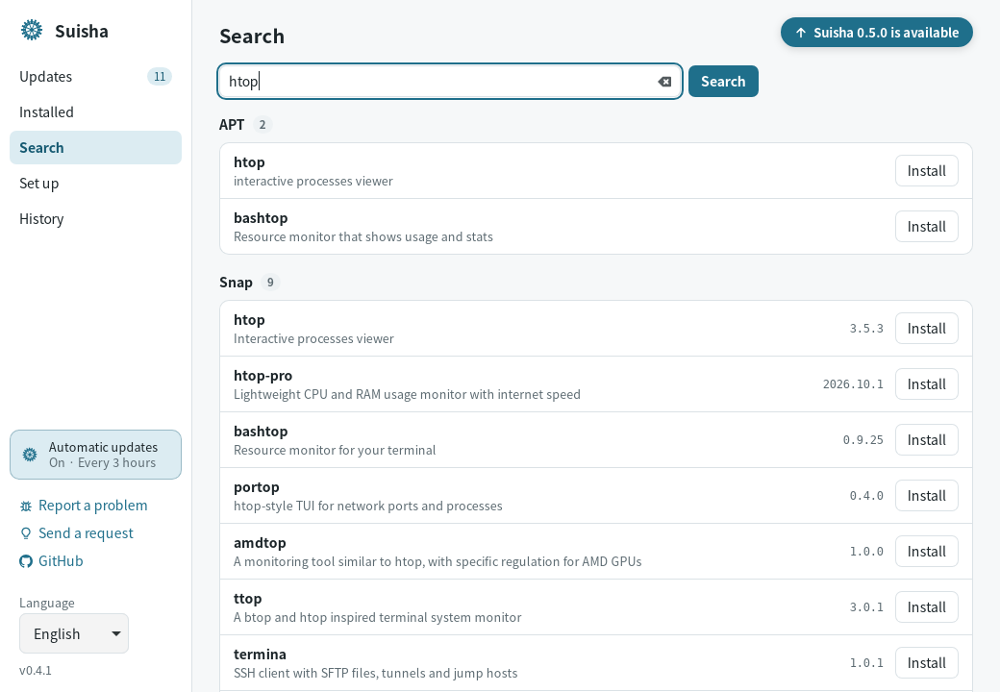
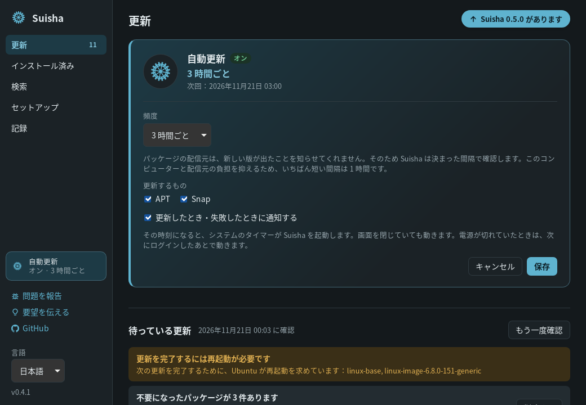
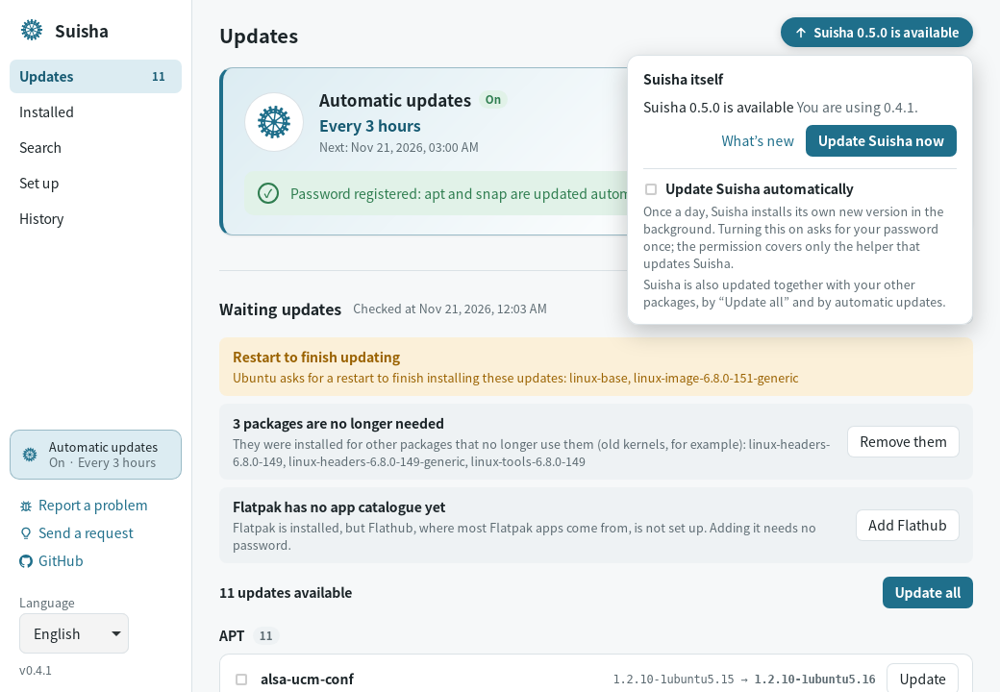

[English](README.md) | 日本語

# Suisha（水車）

[問題の報告・要望はこちら（GitHub Issues）](https://github.com/moriyama-dev/suisha/issues)

Suisha は、Ubuntu に入っているアプリを自動で最新に保つデスクトップアプリです。
すでに使っているパッケージマネージャーを1つの画面にまとめるので、どのアプリをどの道具で入れたかを覚えていなくても、検索・インストール・更新・削除ができます。

**apt**、**snap**、**Flatpak**、**Homebrew**（Linux 版）に対応しています。


## できること

- **自動更新**：1・3・6・12 時間ごと、毎日、または週に1回から選べます。その時刻にシステムのタイマーが Suisha を起動して、すべてを更新します。Suisha の画面を閉じていても動きます。更新したときや失敗したときは通知で知らせます。画面を開いている間は、30 分ごとにも新しい更新がないか確認します
- **まとめて更新**：すべてを一度に、または選んだものだけを更新できます。Ubuntu の段階的な配信（apt があとで自動で入れる更新）は別にまとめて表示するので、件数には今すぐ入れられるものだけが出ます
- **まとめて検索**：すべてのパッケージマネージャーを一度に検索し、結果からそのままインストールできます
- **インストール済みの一覧**：パッケージマネージャーごとに表示し、いらないものを削除できます。依存関係で入ったものや、システムの土台になるパッケージは表示しないので、うっかり消すことはありません
- **新しいコンピューターのセットアップ**：アプリの一覧をファイルに保存し、新しいコンピューターや入れ直したコンピューターで開くと、入っていないものをまとめてインストールします
- **ターミナルを開かなくて済むお知らせ**：更新を完了するために再起動が必要なとき、不要になったパッケージがあるとき（ボタン1つで削除）、Flatpak にアプリの一覧がまだないとき（ボタン1つで Flathub を追加）に知らせます
- **記録**：インストール・削除・更新を、自動で行ったものも含めてすべて記録します。記録を残す期間は、3 日・30 日・100 日・400 日・好きな日数・ずっと残す・残さない、から選べます。初期値は 100 日です
- 英語と日本語に対応しています

Suisha は、パッケージの一覧を自分では持っていません。表示する内容はすべて、このコンピューターのパッケージマネージャーから取得しています。



## インストール

Ubuntu 22.04 以降、x64 に対応しています。

**apt リポジトリから**

```sh
sudo install -d -m 0755 /etc/apt/keyrings
curl -fsSL https://moriyama-dev.github.io/suisha/suisha-archive-keyring.gpg | sudo tee /etc/apt/keyrings/suisha-archive-keyring.gpg > /dev/null
echo "deb [arch=amd64 signed-by=/etc/apt/keyrings/suisha-archive-keyring.gpg] https://moriyama-dev.github.io/suisha stable main" | sudo tee /etc/apt/sources.list.d/suisha.list > /dev/null
sudo apt update
sudo apt install suisha
```

**ダウンロードしたパッケージから**

[Releases](https://github.com/moriyama-dev/suisha/releases) のページから `suisha-<版>-linux-amd64.deb` をダウンロードして、次を実行します。

```sh
sudo apt install ./suisha-0.4.1-linux-amd64.deb
```

どちらの方法でも、以後は Suisha 自体も更新されます。パッケージを入れると、Suisha の apt リポジトリ（`/etc/apt/sources.list.d/suisha.list`）が、まだなければ登録されるためです。
リポジトリの署名鍵のフィンガープリントは `5E50 CE53 AC3D C290 5D94  3D67 F3A3 49A9 8664 021E` です。

## 自動更新のしくみ

Suisha は、裏で常に動いているわけではありません。自動更新をオンにすると、systemd のユーザータイマー（`~/.config/systemd/user/suisha-auto-update.timer`）を登録します。その時刻に電源が切れていたときは、次にログインしたあとで更新します。



パッケージの配信元は新しい版が出たことを知らせてくれないので、Suisha は決まった間隔で確認します。負担を抑えるため、いちばん短い間隔は 1 時間です。

タイマーは `suisha --auto-update` を起動します。選んだパッケージマネージャーをすべて更新し、結果を記録に書き、通知を出します。
自動更新をオフにすると、タイマーは消えます。

### パスワード

apt と snap は管理者の権限が必要です。Suisha は、OS 標準のパスワード入力（polkit）で権限を求めます。

- **手動でインストール・削除・更新するとき**は、パスワードを求められます。入力したパスワードは数分間有効です
- **自動更新**のときは、パスワードを入力する人がいません。そこで、自動更新をオンにするとき（または自動更新の欄の **パスワードを登録** を押したとき）に1回だけパスワードを求め、決まった1つの処理（`/usr/lib/suisha/suisha-auto-update`）に限って、あなたのユーザーがパスワードなしで実行できるようにする polkit のルールを追加します。この処理は引数を受け取らず、`apt-get update`、`apt-get upgrade`、`snap refresh` だけを実行します。ほかの操作がパスワードなしで通るようになることはありません
- 自動更新をオフにすると、もう一度パスワードを求めて、このルールを消します。Suisha を削除したときも消えます

Flatpak と Homebrew は、管理者の権限なしで動きます。

## Suisha 自体の更新

- **ほかのパッケージと一緒に**：Suisha は、自分のリポジトリから配っている apt のパッケージです。「すべて更新」、自動更新、ふつうの `sudo apt upgrade` のどれでも更新されます
- **右上のボタンから**：Suisha の版を表示していて、新しい版が出るとお知らせに変わります。**今すぐ Suisha を更新** で新しい版を入れ、**Suisha を再起動** で切り替えます
- **自動で**：同じ場所の **Suisha を自動で更新する** をオンにします。1日に1回、systemd のユーザータイマーが `suisha --self-update` を実行します。オンにするときに1回だけパスワードを求め、決まった1つの処理（`/usr/lib/suisha/suisha-self-update`）に限って、あなたのユーザーがパスワードなしで実行できるようにします。この処理は引数を受け取らず、Suisha の apt の取得元を更新して `suisha` パッケージを更新するだけです



新しい版があるかを知るため、Suisha は起動したときと、開いている間は 6 時間ごとに、GitHub に最新のリリースを問い合わせます。取得するのは公開されているリリースの情報だけで、あなたやコンピューターの情報は送りません。

## 保存するアプリの一覧

**セットアップ → 一覧を保存…** を選ぶと、次のような JSON ファイルを書き出します。

```json
{
  "format": "suisha-setup",
  "version": 1,
  "os": "linux",
  "exportedAt": "2026-11-20T02:20:07Z",
  "packages": [
    { "manager": "apt", "id": "git" },
    { "manager": "snap", "id": "code", "classic": true },
    { "manager": "flatpak", "id": "org.gimp.GIMP", "name": "GNU Image Manipulation Program", "origin": "flathub", "scope": "system" }
  ]
}
```

中身はパッケージの名前だけです。設定やファイル、個人の情報は入りません。
一覧は、Linux のコンピューターの間で使うためのものです。

## ソースからビルドする

Node.js 22、Rust（stable）、WebKitGTK の開発用ファイルが必要です。

```sh
sudo apt install libwebkit2gtk-4.1-dev libayatana-appindicator3-dev librsvg2-dev libssl-dev libxdo-dev build-essential

git clone https://github.com/moriyama-dev/suisha.git
cd suisha
npm ci
npm run tauri dev          # 開発モードで起動
npm run tauri build        # .deb を作る
```

テスト：

```sh
npm run check                  # 画面の型チェック
cd src-tauri && cargo test     # 出力の解析、スケジュール、一覧ファイル、入力の検査
```

Suisha は [Tauri](https://tauri.app/)（Rust）と [Svelte](https://svelte.dev/) で作っています。
パッケージマネージャーのコマンドはすべて Rust 側で、シェルを通さずに実行し、パッケージ名は渡す前に検査しています。

## ライセンス

[MIT](LICENSE)
