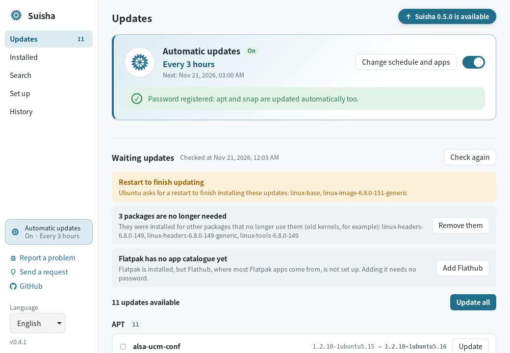
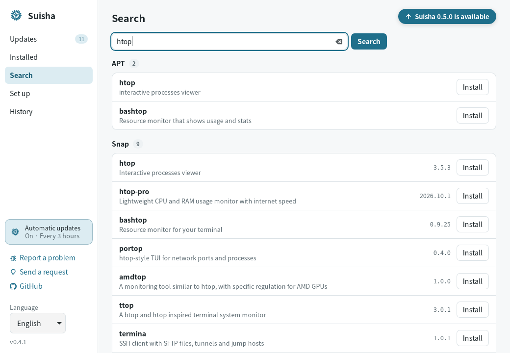
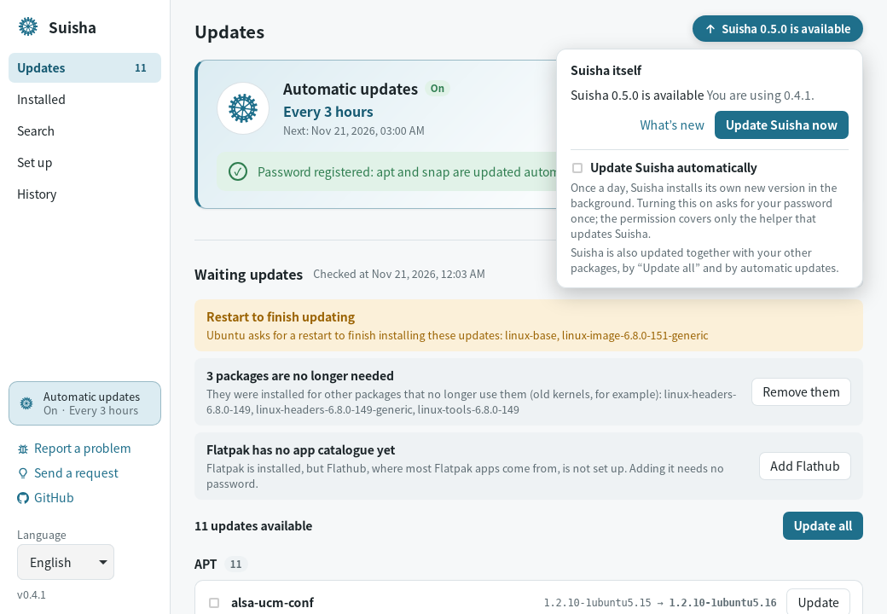

English | [日本語](README.ja.md)

# Suisha

[Report a problem or suggest an idea](https://github.com/moriyama-dev/suisha/issues)

Suisha (水車, "water wheel") is a desktop app for Ubuntu that keeps your apps up to date by itself.
It brings the package managers you already use into one window, so you can search, install, update and remove apps without remembering which tool each one came from.

It works with **apt**, **snap**, **Flatpak** and **Homebrew** (on Linux).



## What it does

- **Automatic updates.** Every 1, 3, 6 or 12 hours, every day, or one day a week. The system's own timer starts Suisha at that time, even when its window is closed, and updates everything. You get a notification when updates were installed or something failed. While the window is open, Suisha also looks for new updates every 30 minutes.
- **Update everything at once**, or only the packages you pick. Ubuntu's phased updates, which apt installs later on its own, are listed separately so that the count shows only what can be installed now.
- **Search every package manager at once** and install from the results.
- **See what you installed**, grouped by package manager, and remove what you no longer need. Dependencies and base system packages are left out, so they cannot be removed by accident.
- **Set up a new computer.** Save the list of your apps to a file, open it on a new or reinstalled computer, and Suisha installs whatever is missing in one go.
- **Notices that save a trip to the terminal:** when Ubuntu needs a restart to finish updating, when packages are no longer needed (one button removes them), and when Flatpak has no app catalogue yet (one button adds Flathub).
- **History** of every install, removal and update, including the automatic ones. You choose how long entries are kept: 3, 30, 100 or 400 days, any number of days you type in, forever, or not at all. The default is 100 days.
- English and Japanese.

Suisha keeps no package catalog of its own. Everything comes from the package managers on your computer, so it shows exactly what they would.



## Install

Ubuntu 22.04 or later, x64.

**From the apt repository**

```sh
sudo install -d -m 0755 /etc/apt/keyrings
curl -fsSL https://moriyama-dev.github.io/suisha/suisha-archive-keyring.gpg | sudo tee /etc/apt/keyrings/suisha-archive-keyring.gpg > /dev/null
echo "deb [arch=amd64 signed-by=/etc/apt/keyrings/suisha-archive-keyring.gpg] https://moriyama-dev.github.io/suisha stable main" | sudo tee /etc/apt/sources.list.d/suisha.list > /dev/null
sudo apt update
sudo apt install suisha
```

**From a downloaded package**

Download `suisha-<version>-linux-amd64.deb` from the [Releases](https://github.com/moriyama-dev/suisha/releases) page and run:

```sh
sudo apt install ./suisha-0.4.1-linux-amd64.deb
```

Either way, Suisha is updated from then on: the package adds Suisha's apt repository (`/etc/apt/sources.list.d/suisha.list`) if it is not there yet.
The repository is signed with the key `5E50 CE53 AC3D C290 5D94  3D67 F3A3 49A9 8664 021E`.

## How automatic updates work

Suisha does not stay running in the background. When you turn automatic updates on, it registers a systemd user timer (`~/.config/systemd/user/suisha-auto-update.timer`). If the computer was off at that time, the update runs after you next log in.

Package servers do not announce new versions, so Suisha checks on a schedule; once an hour is the shortest interval, to keep the load low.

The timer runs `suisha --auto-update`, which updates every package manager you selected, writes the result to the history and shows a notification.
Turning automatic updates off removes the timer.

### Passwords

apt and snap need administrator rights. Suisha asks for them through the standard system password dialog (polkit):

- **When you install, remove or update by hand**, the system asks for your password. It is remembered for a few minutes.
- **For automatic updates**, nobody is there to type a password. When you turn automatic updates on (or press **Register password** on the automatic updates card), Suisha asks for your password once and adds a polkit rule that lets your user run one fixed helper, `/usr/lib/suisha/suisha-auto-update`, without a password. That helper takes no arguments and only runs `apt-get update`, `apt-get upgrade` and `snap refresh`. Nothing else becomes password-free.
- Turning automatic updates off asks for your password once more and removes the rule. Removing Suisha removes it too.

Flatpak and Homebrew work without administrator rights.

## Updating Suisha itself

- **With everything else.** Suisha is an apt package from its own repository, so "Update all", automatic updates and a plain `sudo apt upgrade` all update it.
- **From the button in the top right corner.** It shows Suisha's version and turns into a notice when a new version is out. **Update Suisha now** installs it, and **Restart Suisha** starts the new version.
- **Automatically.** Turn on **Update Suisha automatically** in that same place. Once a day a systemd user timer runs `suisha --self-update`. Turning it on asks for your password once and lets your user run one fixed helper, `/usr/lib/suisha/suisha-self-update`, without a password. That helper takes no arguments and only refreshes Suisha's own apt source and upgrades the `suisha` package.



To know about new versions, Suisha asks GitHub for its latest release when it starts and every 6 hours while it is open. Only the public release information is requested; nothing about you or your computer is sent.

## The saved app list

**Set up → Save list…** writes a JSON file like this:

```json
{
  "format": "suisha-setup",
  "version": 1,
  "os": "linux",
  "exportedAt": "2026-11-20T02:20:07Z",
  "packages": [
    { "manager": "apt", "id": "git" },
    { "manager": "snap", "id": "code", "classic": true },
    { "manager": "flatpak", "id": "org.gimp.GIMP", "name": "GNU Image Manipulation Program", "origin": "flathub", "scope": "system" }
  ]
}
```

It contains package names only: no settings, files or personal data.
Lists are for moving between Linux computers.

## Build from source

You need Node.js 22, Rust (stable) and the WebKitGTK development files:

```sh
sudo apt install libwebkit2gtk-4.1-dev libayatana-appindicator3-dev librsvg2-dev libssl-dev libxdo-dev build-essential

git clone https://github.com/moriyama-dev/suisha.git
cd suisha
npm ci
npm run tauri dev          # run in development mode
npm run tauri build        # build the .deb
```

Tests:

```sh
npm run check                  # type-check the interface
cd src-tauri && cargo test     # parsers, scheduling, setup files, input checks
```

Suisha is built with [Tauri](https://tauri.app/) (Rust) and [Svelte](https://svelte.dev/).
All package manager commands run on the Rust side, without a shell, and package names are checked before they are passed on.

## License

[MIT](LICENSE)
